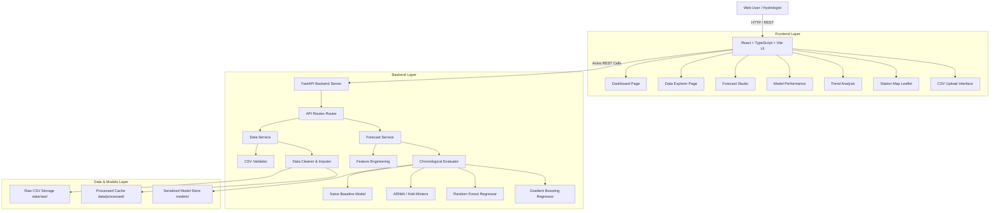

# System Architecture — Groundwater Level Prediction System

## 1. Overview
The Groundwater Level Prediction System is designed as a decoupled, multi-tier web application consisting of a React + TypeScript single-page dashboard frontend, a Python FastAPI REST API server, and a Machine Learning time-series forecasting & evaluation pipeline.

---

## 2. System Architecture Diagram



---

## 3. End-to-End Data Processing & Forecasting Pipeline

```text
Raw CSV / DWLR Data
        │
        ▼
Validation & Normalization (preprocessing/validator.py)
        │
        ▼
Cleaning & Missing Value Imputation (preprocessing/cleaner.py)
        │
        ▼
Feature Engineering & Lag Generation (preprocessing/feature_engineering.py)
        │
        ▼
Chronological Train/Test Split 80/20 (forecasting/evaluator.py)
        │
        ▼
Model Training & Evaluation (Naive, ARIMA, Random Forest, GBR)
        │
        ▼
Best Model Auto-Selection & Metric Calculation (MAE, RMSE, R², MAPE)
        │
        ▼
Recursive Multi-Step Horizon Forecast & 95% Confidence Interval
        │
        ▼
FastAPI REST JSON Endpoint Response (/api/forecast)
        │
        ▼
Recharts & Leaflet Interactive Visualization (React Frontend)
```

---

## 4. Layer Communication & API Protocols

- **Protocol**: HTTP/1.1 REST with JSON payloads (`Content-Type: application/json`).
- **File Ingestion**: Multipart form data (`multipart/form-data`) for CSV dataset uploading.
- **CORS Middleware**: Configured to accept cross-origin requests from Vite dev server (`http://localhost:5173`).
- **Error Handling**: Standard HTTP status codes (200 OK, 400 Bad Request, 404 Not Found, 500 Internal Server Error) with descriptive error details.
